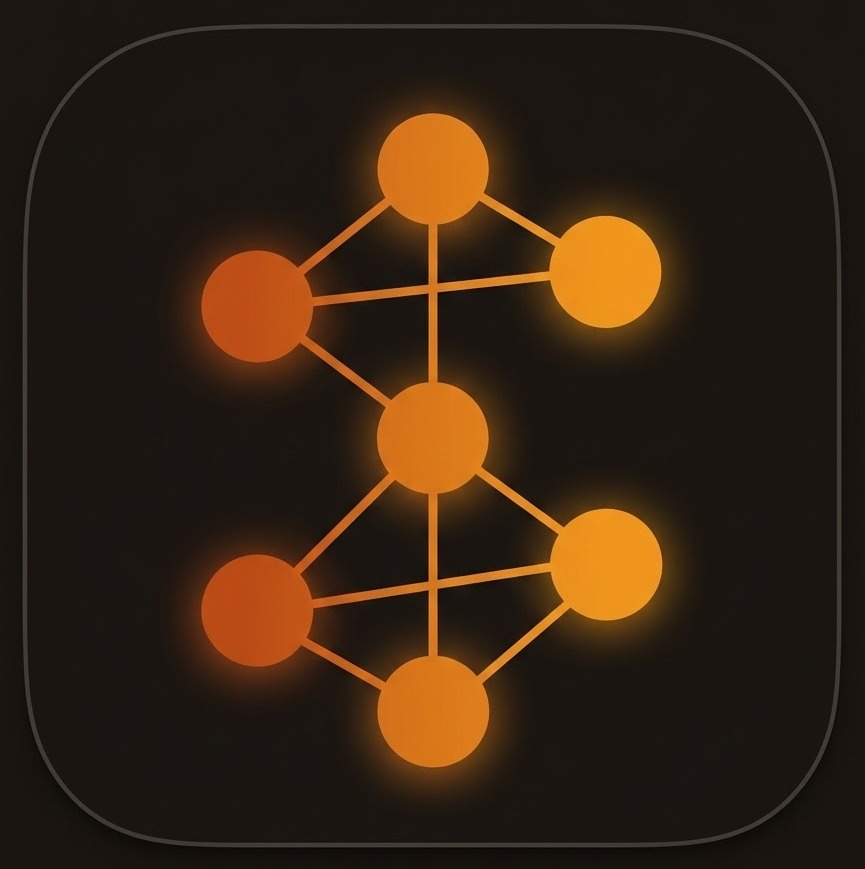
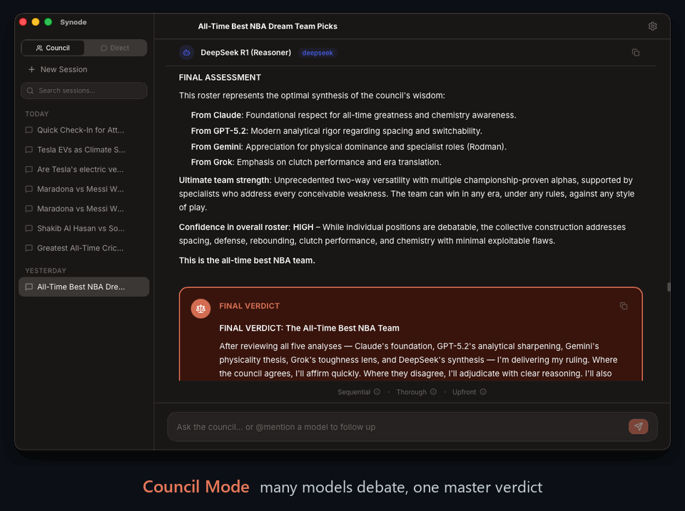
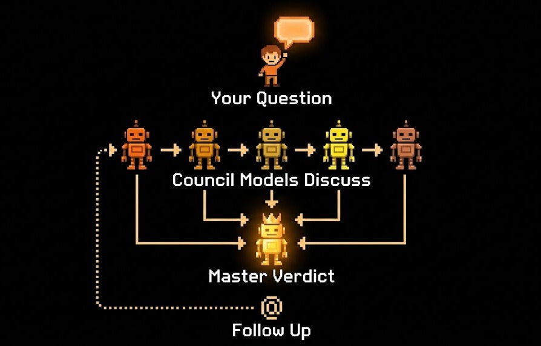
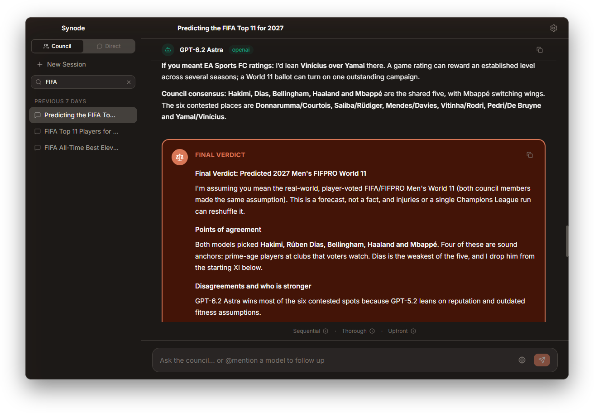
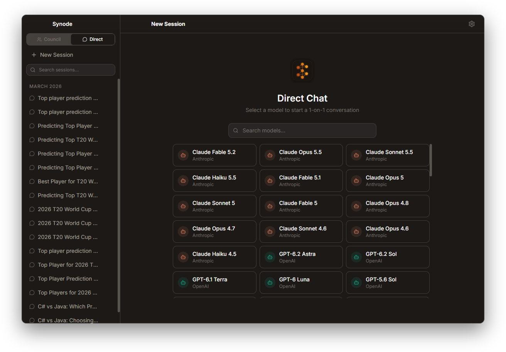
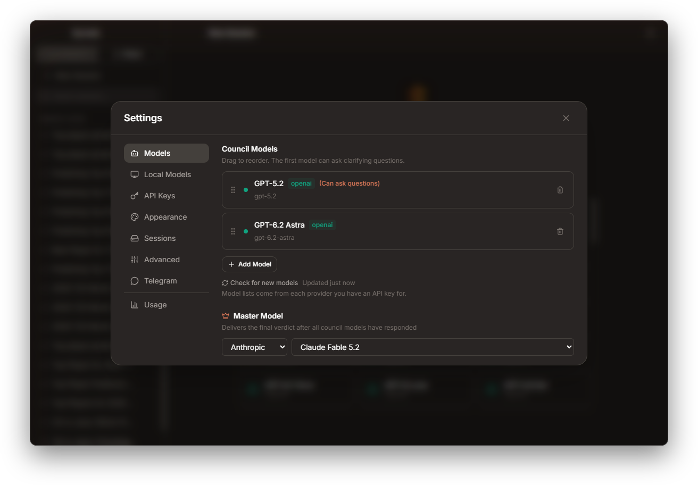
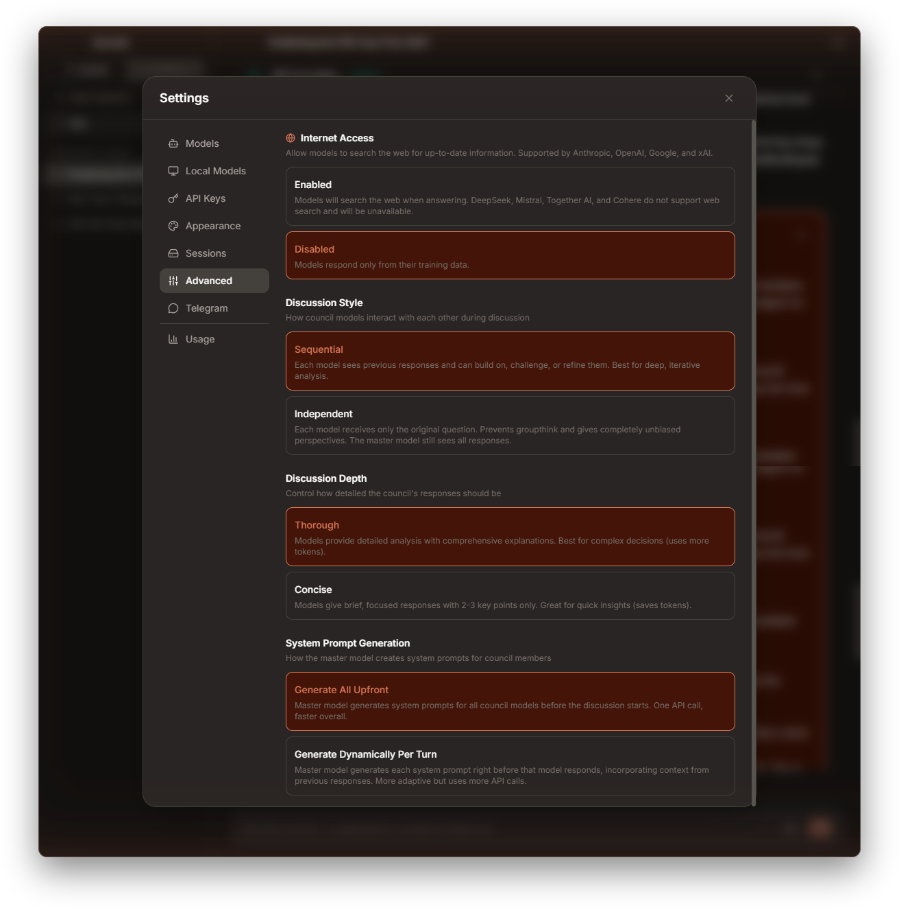

<p align="center">
  
</p>

<h1 align="center">Synode</h1>

<p align="center">
  <strong>A council of AI models, one definitive verdict.</strong>
</p>

<p align="center">
  <a href="LICENSE"></a>
  
  
  
  
</p>

<p align="center">
  <a href="https://github.com/mahatab/synode-council-of-ai-agents/releases/latest"></a>
  <a href="https://github.com/mahatab/synode-council-of-ai-agents/releases/latest"></a>
</p>

<p align="center">
  
</p>

<p align="center">
  <strong>New in v0.5.0:</strong> always-current model lists. Synode asks each provider which models it offers,<br />
  so a new model shows up the day it is released, with no app update.
  <a href="https://github.com/mahatab/synode-council-of-ai-agents/releases/tag/v0.5.0">Release notes</a>
</p>

---

Synode is a desktop app for **macOS and Windows** that assembles a **council of AI models** to collaboratively tackle your questions. Multiple models from different providers discuss the topic - either sequentially (building on each other) or independently (preventing groupthink) - then a **master model** synthesizes everything into a clear, actionable verdict. You can also switch to **Direct Chat** mode for 1-on-1 conversations with any individual model.

## How It Works


You ask a question, and your council of AI models responds. In **Sequential** mode (as shown above), each model sees the full discussion so far, responding one by one. In **Independent** mode, each model only sees your original question and responds **in parallel** for faster results and unbiased perspectives. Once everyone has weighed in, a master model synthesizes all perspectives into a clear, actionable verdict. After the verdict, @mention any model to ask follow-up questions with full context.

## Features

### Two Modes
- **Council Mode** — assemble a panel of AI models for collaborative discussion and a synthesized verdict
- **Direct Chat** — 1-on-1 conversations with any chat model from 8 cloud providers and local models, with multi-turn history and streaming

### Always-Current Model Lists
- **Live model discovery** — Synode asks each provider which chat models it offers, using your own API key, so new models appear the day they are released
- **Works offline** — a built-in list of featured models is the fallback when a provider cannot be reached
- **Refresh on demand** — lists update when the app starts, when you add a key, and from **Check for new models** in Settings

### Council Discussion
- **8 cloud providers + local models** — Anthropic, OpenAI, Google, xAI, DeepSeek, Mistral, Together AI, Cohere, and LM Studio
- **Discussion styles** — Sequential (each model builds on previous responses) or Independent (each model responds without seeing others, preventing groupthink)
- **Parallel execution** — In Independent mode, models 1..N stream their responses simultaneously for faster results, with a real-time Council Progress overlay tracking each model's status
- **Master verdict** — a designated model synthesizes all opinions into a final recommendation

### Direct Chat
- **Agent picker** — searchable grid of all available models, sorted by API key availability
- **Multi-turn conversations** — full conversation history with streaming responses
- **Auto-save** — sessions are saved after every response with AI-generated titles
- **Provider color coding** — each model is visually identified by its provider

### Follow-Up @Mentions 
- After the verdict, type **`@`** to mention any council member or the master model
- Ask follow-up questions with **full discussion context** — the model sees every response, not just its own
- Cross-reference freely: *"@Grok what do you think about GPT's suggestion?"*
- Chain unlimited follow-ups within the same session

### Smart Prompt Engineering 
- **Upfront mode** — master generates tailored system prompts for all council members before the discussion starts
- **Dynamic mode** — master generates a custom prompt for each model right before its turn, incorporating context from previous responses

### Discussion Depth 
- **Thorough** — detailed analysis with comprehensive reasoning
- **Concise** — 2-3 key points per model, optimized for speed and cost
- Active settings are always visible in the chat view with (i) tooltips explaining each option

### Session Management
- Auto-save after every response — never lose a discussion
- AI-generated session titles
- Searchable history grouped by date
- Custom storage location

### Token Usage & Cost Tracking
- Per-model input/output token counts
- **Estimated USD cost** per model and grand total, powered by [tokentally](https://github.com/steipete/tokentally) with built-in pricing for the featured models
- Dedicated **Usage tab** in Settings — separates read-only analytics from editable model configuration
- Summary stat cards showing total tokens, total cost, and models used at a glance

### Telegram Bot Integration
- **Built-in Telegram bot** — chat with Synode from any device
- **Council and Direct Chat** — both modes available via `/council` and `/chat` commands
- **Shared config** — uses the same API keys, models, and settings as the desktop app
- **Auto-start** — bot launches with the app when enabled in Settings
- See [Telegram Bot docs](docs/TELEGRAM_BOT.md) for setup instructions

### Internet Access (Web Search)
- **Live web search** — models can search the web for up-to-date information when answering
- **4 supported providers** — Anthropic (`web_search` tool), Google (`google_search` grounding), OpenAI (Responses API), xAI (Responses API, Grok 4 family)
- **Automatic model filtering** — unsupported providers (DeepSeek, Mistral, Together AI, Cohere) are excluded from council when internet is enabled, with amber warnings showing which models are skipped
- **Globe toggle** — enable/disable from the chat input area or Advanced Settings
- **Smart prompting** — system prompt nudge instructs models to actively use their search tools
- **Telegram bot support** — web search works in Telegram council and direct chat when enabled in desktop settings

### Local Models (LM Studio)
- **Run models locally** — use any model from LM Studio alongside cloud providers, free, private, and offline
- **Dedicated settings tab** — setup guide, server status monitoring, base URL configuration, and dynamic model discovery
- **No API key required** — Synode connects to your local LM Studio server automatically
- **Full integration** — local models work in Council Mode, Direct Chat, and Telegram bot with a green "Local" badge for clear identification
- **Mix and match** — combine local and cloud models in the same council discussion

### Polished UX
- **Real-time streaming** with 4 animated cursor styles (ripple, breathing, orbit, multi-caret)
- **Dark mode** support
- **Drag-and-drop** model reordering
- **Secure API key storage** — macOS Keychain or Windows Credential Manager
- **Setup wizard** with built-in API key instructions for each provider
- **External links** — URLs in model responses open in the system default browser

## Screenshots

<p align="center">
  
</p>
<p align="center"><em>Many models, one verdict — watch your council think through the problem, then @mention anyone to keep talking</em></p>

<p align="center">
  
</p>
<p align="center"><em>Direct Chat — pick any model for a 1-on-1 conversation, with every available model at your fingertips</em></p>

<p align="center">
  
</p>
<p align="center"><em>Configure your council — choose from 8 providers and their current models, with API keys secured in your OS credential store</em></p>

<p align="center">
  
</p>
<p align="center"><em>Local Models — run AI models on your own machine via LM Studio, with setup guide and live server status</em></p>

<p align="center">
  
</p>
<p align="center"><em>Telegram Integration — chat with your council from any device via a built-in Telegram bot</em></p>

<p align="center">
  
</p>
<p align="center"><em>Control your council with prompt engineering modes</em></p>

### Demo

▶️ [Watch the demo video](https://youtu.be/BvqSjLuyTaA?si=UF8waoQEv-GQ2JNj) *(recorded on an earlier version)*

## Supported Providers

| Provider | Models | Web Search |
|----------|--------|:----------:|
| **Anthropic** | Claude Fable 5.2, Opus 5.5, Sonnet 5.5, Haiku 5.5 | ✅ |
| **OpenAI** | GPT-6.2 Astra, GPT-6.2 Sol, GPT-6.1 Terra, GPT-6 Luna, GPT-5.6 Sol, GPT-5.2 | ✅* |
| **Google** | Gemini 4 Carbon, Gemini 4 Neon, Gemini 4 Hydrogen, Gemini 3.8 Flash, Gemini 3.5 Flash-Lite | ✅ |
| **xAI** | Grok 4.7, Grok 4.6, Grok 4.3 | ✅ |
| **DeepSeek** | DeepSeek V4 Pro, DeepSeek V4.1 Flash | — |
| **Mistral** | Mistral Large, Mistral Small, Codestral | — |
| **Together AI** | Kimi K3.1 Pro, GLM-5.3, Qwen4 Max, DeepSeek V4.1 Flash, GPT-OSS 120B | — |
| **Cohere** | Command A+, Command A, Command R+ | — |

\* OpenAI: all featured models except GPT-5.6 Sol

These are the models built into the app. Synode also asks each provider you have an API key for which chat models it currently offers, so newly released models show up in the pickers without an app update. Models found this way have no cost estimate until a later release adds their price.

> Cloud provider API keys are stored locally in the OS credential store (macOS Keychain or Windows Credential Manager) — never sent anywhere except the provider's own API. LM Studio models run entirely on your machine with no API key required.

## Quick Start

### Prerequisites

- **macOS** 10.15+ or **Windows** 10+
- **Rust** 1.77+ &mdash; [install via rustup](https://rustup.rs/)
- **Node.js** 18+ &mdash; [download](https://nodejs.org/)
- **Tauri CLI** v2 &mdash; `cargo install tauri-cli --version "^2"`

### Run

```bash
git clone https://github.com/mahatab/Council-of-AI-Agents.git
cd Council-of-AI-Agents
npm install
cargo tauri dev
```

A setup wizard will guide you through configuring your council models, master model, and API keys on first launch.
## Building

```bash
cargo tauri build
```

**macOS** — produces `src-tauri/target/release/bundle/macos/Synode.app` and `.dmg`

**Windows** — produces `src-tauri/target/release/bundle/nsis/Synode_x.x.x_x64-setup.exe` and `.msi`

## Architecture

```
Cargo.toml                    Workspace root
├── src-tauri/                Tauri desktop app (Rust backend)
│   ├── commands/             stream_chat, keychain, sessions, settings, telegram, window
│   └── lib.rs                App setup, menu, About window, bot auto-start
├── crates/council-core/      Shared library
│   ├── providers/            9 AI provider integrations (8 cloud + LM Studio) with SSE streaming
│   ├── models/               Config, session, discussion entry types
│   ├── keychain/             macOS Keychain / Windows Credential Manager
│   ├── sessions.rs           Session storage
│   └── settings.rs           Settings persistence
├── crates/telegram-bot/      Telegram bot (embedded + standalone)
│   ├── council.rs            Council orchestration for Telegram
│   ├── direct_chat.rs        1-on-1 chat with any model
│   ├── handlers.rs           8 slash commands + message routing
│   └── formatting.rs         Markdown-to-Telegram-HTML converter
└── src/                      React + TypeScript frontend
    ├── components/
    │   ├── chat/             ChatView, DirectChatView, AgentPicker,
    │   │                     ModelResponse, MasterVerdict, MentionDropdown,
    │   │                     FollowUpQuestion, ClarifyingQuestion,
    │   │                     ParallelStatusOverlay, StreamingText
    │   ├── settings/         Models, Local Models, API Keys, Appearance, Sessions, Usage, Telegram
    │   ├── about/            About Synode window (separate webview)
    │   ├── setup/            First-run wizard
    │   └── common/           Button, Toggle, Modal
    ├── stores/               Zustand stores (council, directChat, settings, session)
    ├── lib/                  Tauri IPC bindings, theme, markdown, sessionTitle, pricing
    └── types/                TypeScript definitions
```

### Tech Stack

| Layer | Technology |
|-------|-----------|
| Desktop framework | Tauri v2 (Rust + native WebView) |
| Frontend | React 19, TypeScript 5.9 |
| Build tool | Vite 7 |
| Styling | Tailwind CSS v4 |
| State management | Zustand |
| Animations | Framer Motion |
| Icons | Lucide React |
| Drag-and-drop | dnd-kit |
| Markdown | react-markdown + remark-gfm |
| Cost estimation | tokentally |
| External links | tauri-plugin-opener (system default browser) |
| API key storage | macOS Keychain / Windows Credential Manager |
| Async runtime | Tokio |
| HTTP streaming | reqwest + futures with SSE line buffering |
| Telegram bot | teloxide |

## Documentation

Detailed docs live in the [`docs/`](docs/) directory:

- [Architecture](docs/ARCHITECTURE.md) — system design, state machine, streaming pipeline
- [API Providers](docs/API_PROVIDERS.md) — endpoints, auth methods, streaming formats
- [Adding Providers](docs/ADDING_PROVIDERS.md) — step-by-step guide to add new AI providers
- [Setup Guide](docs/SETUP_GUIDE.md) — installation and configuration walkthrough
- [Telegram Bot](docs/TELEGRAM_BOT.md) — setup, commands, standalone deployment

## Contributing

Contributions are welcome! See [CONTRIBUTING.md](CONTRIBUTING.md) for development setup, code style, and PR guidelines.

## License

MIT &mdash; see [LICENSE](LICENSE) for details.
